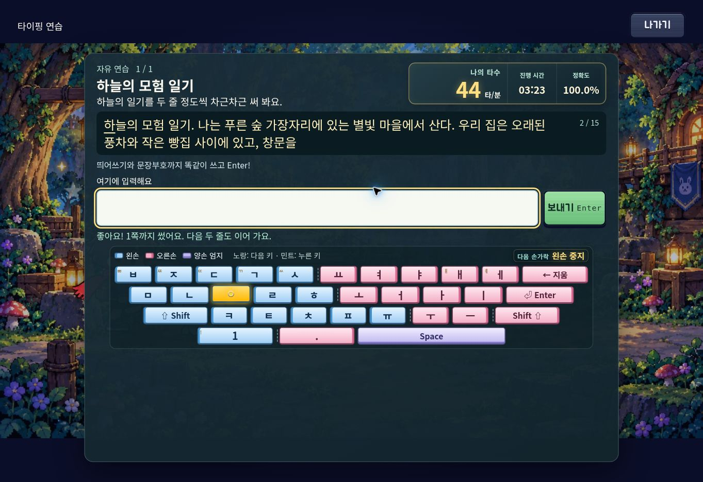

# AI Mart 20번 타이핑 어드벤처 태블릿 검수

검수일: 2026-10-18 (KST). 판정: **기존 자판 배치 개선 확인 / 긴 글 제시문 갱신 오류 추가 수정 / 운영 반영과 실기기 검수 대기**.

## 원본 요청과 배포 버전

- [운영 시트](https://docs.google.com/spreadsheets/d/1sOjskD1i8S6_QdPdU2M81O1g2H5nTQnLXFe7KUyGN1g/edit), `이예리 선생님` 탭, NO.20, 실제 행 25, 수정 의견 `K25`.
- 요청 1: 긴 글 등 타자 연습에서 자판 마지막 줄까지 한 화면에 표시.
- 요청 2: 학생이 태블릿 화면 키보드를 사용하는 상황 고려.
- [실제 배포본](https://typing-adventure-six.vercel.app/)은 Vercel 조회 시 production READY `dpl_2XzfBFNFBGdMALqEFMqtsTnVDtk7`, 연결 커밋 `e6a841a8dacdeeadc1f0c4e3e610e8d07d8a6a4b`. 이 검수의 수정은 아직 배포되지 않았다.
- `f30de6a` → `896df2d` → `e6a841a`는 같은 main 이력에 포함된다. 수정 전 로컬 빌드의 진입 JS `index-B8GRhHCY.js`와 CSS `index-DQjr6alM.css`는 배포 HTML의 파일명과 일치했다. 이는 전체 배포 파일의 바이트 해시 비교를 대신하지 않는다.

## 확인 결과

| 항목 | 결과 | 범위 및 한계 |
| --- | --- | --- |
| 자판 마지막 줄·스페이스바 | 기존 개선 정상 | 공개 사이트의 긴 글 화면에서 직접 확인. 동일 소스의 가로 화면 1024×768, 1180×820, 1280×800, 1024×600에서 한영 모두 표시 확인. |
| 화면 키보드가 열릴 때 | 시뮬레이션 정상 | 높이를 360px로 축소하는 layout viewport 방식과 visualViewport만 축소하는 방식을 각각 검사. 안내 자판은 숨고, 제시문·입력창·보내기가 표시되며 부분 입력과 포커스 유지. |
| 화면 키보드가 닫힐 때 | 시뮬레이션 정상 | 원래 크기로 복구하면 안내 자판 마지막 줄과 스페이스바가 돌아옴. |
| 긴 글 다음 구간 | **운영 오류 재현, 코드 수정** | 정답 제출 후 진행 번호만 2/15가 되고 표시 글은 첫 구간에 멈춤. 내부 정답과 표시 글 불일치. |
| 실제 iPad/Galaxy 키보드·한글 IME | 미검수 | 물리 기기와 실제 OS 키보드를 사용하지 않았다. 합성 IME 이벤트는 실기기 검수를 대신하지 않는다. |

가로 화면 레이아웃은 기존 코드를 유지했다. 1024×600 영어 화면은 피드백 뒤 패널 내부에 9 design px의 초과 높이가 남지만, 검사 대상 제시문·입력창·마지막 자판 줄·스페이스바는 모두 표시됐다.

## 배포본에서 직접 재현한 오류

홈 → 타이핑 연습 선택 → 짧은 글 → 하늘의 일기 → 첫 구간을 입력하고 Enter.

- 진행 번호: `2 / 15`.
- 화면 표시: `하늘의 모험 일기. 나는 푸른 숲 가장자리에…`로 시작하는 첫 구간이 그대로 남음.
- 같은 DOM 요소의 `data-target`: `열면 솔잎 냄새와 갓 구운 식빵 냄새가 함께 들어온다.…`로 시작하는 다음 구간.
- 한국어뿐 아니라 영어도 수정 전 소스에서 동일 회귀 검사가 실패했다.



## 최소 수정

`src/game/ui/screens/TutorialScreen.ts`의 제출 처리 두 곳에서 `paint()` 실행 전에 `target.dataset.target`을 새 값으로 덮어쓰던 코드를 제거했다.

`paint()`는 기존 값과 다음 정답의 차이를 확인해 `bindTarget()`으로 실제 글자 노드를 갱신한다. 기존 코드가 값을 미리 같게 만들어 이 처리를 건너뛰고 있었다. 정답 후 다음 구간과 오답 시 초기화가 모두 이 경로를 사용한다. CSS, 화면 키보드 감지, 글감, 저장 형식은 변경하지 않았다.

## 검증 증거

- `npm run build`: 통과 (TypeScript 검사 포함).
- `npm run check:gameplay`: 통과.
- `git diff --check`: 통과.
- `scripts/check-tablet-practice.mjs`: 4종 가로 크기 × 한국어/영어 × 7개 상태 = **56개 화면 상태 통과**, 런타임 오류 0.
- 1280×800에서는 한국어 4편·영어 4편을 실제 제출 경로로 끝까지 완성하고 다시 열기 버튼 4개가 생성되는 것까지 확인했다. 한국어는 조합 중 Enter → compositionend 합성 이벤트 경로도 사용했다.
- 수정 전 `e6a841a`에 같은 회귀 검사를 적용하면 한영 모두 첫 제출 직후 `Displayed text must advance with the accepted target` assertion이 실패한다.
- 결과: [화면 상태 요약 JSON](tablet-20261018/results.json). 브라우저 자동 검사이며 실기기 검수 결과가 아니다.

재현 명령 (Playwright Chromium 설치 필요):

```sh
npm ci
npx playwright install chromium
node scripts/check-tablet-practice.mjs
```

검사 스크립트는 자체 Vite 서버와 격리된 테스트 프로필을 사용한다. 이미 실행 중인 브라우저의 저장 기록을 초기화하지 않는다. `TABLET_TEST_SIZE=1024x768`로 한 크기만 선택할 수 있다. 스크린샷은 `tmp/tablet-practice/`에 생성된다.

이 환경의 별도 자동화 브라우저는 원격 사이트 접속 시 인증서 신뢰 오류로 연결하지 못했다. TLS 검증을 끄지 않았다. 운영 오류는 연결된 Cloud Browser에서 직접 재현했고, 크기별 자동 검사는 로컬 소스에서 실행했다.

## 운영 시트에 반영할 상태

원문 K25와 서식은 보존하고 셀 메모에 검수 범위, 추가 오류, 수정 PR 및 **운영 미배포 / 실기기 검수 대기** 상태를 기록한다. 전체 완료로 표시하지 않는다.

운영 반영 뒤에는 새 탭에서 긴 글 1→2구간 표시를 다시 확인하고, 실제 iPad Safari와 Galaxy Chrome에서 가로 방향·키보드 열기/닫기·한글 조합 Enter를 확인해야 최종 완료 판정을 할 수 있다.
